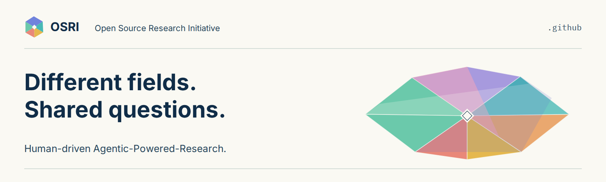

# Open Source Research Initiative (OSRI)

English | [简体中文（待审核）](https://github.com/Open-Source-Research-Initiative/.github/blob/main/translations/zh-Hans/profile/README.md)

The Open Source Research Initiative (OSRI) helps people develop research and submit it through publication routes that are free to authors. It is founder-led and seeks collaborators from different fields. People direct Agentic-Powered-Research and track questions, evidence, analyses, and findings in Git so others can follow and extend the work.

**Agentic-Powered-Research is human-driven:** people define the research questions, direct the work, and evaluate the evidence and conclusions.

## Find a free publication route

Use the [searchable publication directory](https://open-source-research-initiative.github.io/venues/) or its [GitHub repository](https://github.com/Open-Source-Research-Initiative/free-publication-directory) to compare venues within a research field. Records separate submission and publication costs, link AI policies and disclosure instructions, distinguish venue and publisher geography from author eligibility, and include reported acceptance and citation metrics. Conditional funding and incompletely verified routes stay separate from verified free routes.

Read the [free publication guide](https://open-source-research-initiative.github.io/guides/publications/free-publication/) and the venue's current author instructions before choosing a target. Listed venues must permit substantive AI-assisted research, analysis or code, and manuscript drafting with human responsibility and disclosure. Missing costs, eligibility rules, and metrics remain unverified.

## Start researching

Follow the [short research guide](https://github.com/Open-Source-Research-Initiative/osri/blob/main/START_HERE.md), from a first question to an output you can share. Use the [research repository template](https://github.com/Open-Source-Research-Initiative/research-repository-template) when ready.

Browse the [research directory](https://github.com/Open-Source-Research-Initiative/osri/blob/main/projects/README.md). Each study has its own repository, named after its paper or working title. Read the repository README for the question and current state, open **Issues** for tasks, and use **Pull requests** to propose changes.

Start with **[Medical XR: from capabilities to sustainable use](https://github.com/Open-Source-Research-Initiative/medical-xr-from-capabilities-to-sustainable-use)** or [choose another contribution](https://github.com/Open-Source-Research-Initiative/osri/blob/main/CONTRIBUTING.md). Follow [contributor activity](https://github.com/Open-Source-Research-Initiative/osri/blob/main/community/ACTIVITY.md).

Find [research topics](https://github.com/Open-Source-Research-Initiative/osri/tree/main/topics), [resources](https://github.com/Open-Source-Research-Initiative/osri/tree/main/resources), and [shared rules](https://github.com/Open-Source-Research-Initiative/osri/blob/main/governance/contribution-standards.md) in the [OSRI hub](https://github.com/Open-Source-Research-Initiative/osri). Your own agent is welcome; no paid tool bundle is required.

Join the [starter discussion](https://github.com/Open-Source-Research-Initiative/.github/discussions/1) for the main links and help getting started.

[French and Spanish maintainers wanted; Chinese reviewers welcome](https://github.com/Open-Source-Research-Initiative/.github/discussions/3).

Follow the guides for [writing](https://github.com/Open-Source-Research-Initiative/osri/blob/main/governance/writing-style.md), [translation](https://github.com/Open-Source-Research-Initiative/osri/blob/main/governance/translation.md), and [visual identity](https://github.com/Open-Source-Research-Initiative/osri/blob/main/governance/visual-identity.md).

## Mission

To bring people across disciplines together to lead Agentic-Powered-Research, synthesize evidence, and find answers through open, traceable research.

## Vision

A research community where people lead Agentic-Powered-Research across fields and connect existing knowledge. They build on a shared research record to reach answers more quickly and reliably.

## Research areas

OSRI will begin with Healthcare, Engineering, Informatics, Economics, Social and Behavioral Sciences, and Public Policy, with room for related questions and contributions from other disciplines.

- **Healthcare:** Public health, health systems research, evidence synthesis, and meta-analysis, with an initial focus on nonclinical research.

- **Engineering:** Systems engineering, engineering management, Operations Research, and Decision Science, using research methods that do not require physical laboratory experiments.

- **Informatics:** Bioinformatics, health and research informatics, information systems, and Computational Natural Sciences, including computational biology, chemistry, physics, and materials modeling. Work uses existing evidence, data, and computational methods without physical laboratory experiments.

- **Economics:** Health and public economics, incentives, resource allocation, and the economics of research and innovation.

- **Social and Behavioral Sciences:** Human judgment, collaboration, organizational behavior, and how people work with Agentic-Powered-Research.

- **Public Policy:** Policy analysis and evaluation, governance, institutions, technology policy, and public programs.

Evidence synthesis, meta-analysis, modeling, and simulation can support research across these areas. Specific research questions and projects will develop with collaborators.

## OSRI Simulation Lab

The proposed **OSRI Simulation Lab** would support virtual experiments across the research areas. It would support computational investigations of processes normally studied in laboratories. People would direct the work, assess the models and evidence, and determine which conclusions the results support.

## Publication goals

OSRI prioritizes credible venues with free submission and a free standard publication route. Research outputs can include journal articles, full conference papers, preprints such as arXiv, and substantive research blogs and technical essays.

Publication outputs will be tracked by type. Related outputs will link to the same research work. This will let OSRI report both publication volume and the number of distinct works. Peer-review status will be recorded separately.

## Meta-research and administration

OSRI's administrators will study and improve the group's research practices, including reproducibility, evidence quality, collaboration, and the use of Agentic-Powered-Research. This organization-wide meta-research is part of administering OSRI across its repositories and the shared Simulation Lab.

The role includes evaluating how Agentic-Powered-Research affects research quality, collaboration, time, and use of resources. Administrators also maintain shared research records and use findings to improve how OSRI works.

## Invitation to collaborate

OSRI is looking for collaborators who bring knowledge from their field, questions worth investigating, or experience developing research tools and methods. Help shape the first projects and work across disciplines to find answers through human-driven Agentic-Powered-Research.

Ask questions or request resources in [Q&A](https://github.com/Open-Source-Research-Initiative/.github/discussions/categories/q-a). Propose research topics in [Ideas](https://github.com/Open-Source-Research-Initiative/.github/discussions/categories/ideas).

Share publications, models, and useful work in [Show and tell](https://github.com/Open-Source-Research-Initiative/.github/discussions/categories/show-and-tell).

For confidential resource requests, contact [Cole](mailto:cole.lyons@pennmedicine.upenn.edu) to agree on access and delivery.
